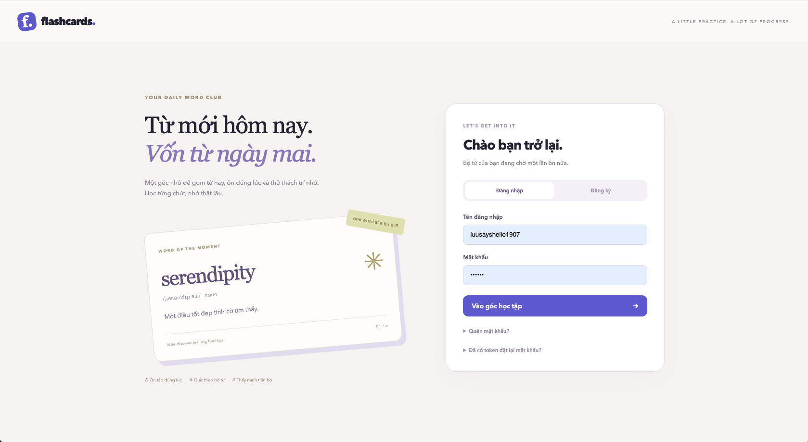

# Flashcards API

## TL;DR

Ứng dụng hỗ trợ học từ vựng bằng flashcard. Người dùng tạo bộ thẻ theo chủ đề, thêm từ cần học và sử dụng dữ liệu từ điển để hiểu nghĩa, cách phát âm và cách dùng. Sau đó, người dùng ôn tập theo lịch Leitner, làm quiz và theo dõi tiến độ học.

Backend sử dụng **FastAPI, SQLAlchemy, PostgreSQL và Docker Compose**.

## Chức năng chính

- **Tài khoản:** đăng ký, đăng nhập và đặt lại mật khẩu qua email. Mỗi người dùng quản lý bộ thẻ của riêng mình.
- **Deck & card:** tạo bộ thẻ (deck) theo chủ đề; thêm từ thành flashcard, ghi chú, chỉnh sửa, chuyển thẻ giữa các deck hoặc xóa khi không còn cần.
- **Từ điển:** tự tra từ khi thêm flashcard, lưu định nghĩa, ví dụ, phiên âm IPA, audio, từ đồng nghĩa và trái nghĩa khi có dữ liệu. Nếu không tìm thấy từ, hệ thống báo lỗi và không tạo thẻ.
- **Ôn tập theo Leitner:** đề xuất thẻ đến hạn hoặc chưa từng ôn. Người dùng xem đáp án rồi tự đánh dấu đúng/sai để hệ thống điều chỉnh lịch ôn tiếp theo.
- **Quiz:** tự kiểm tra bằng trắc nghiệm hoặc điền từ vào câu ví dụ. Hệ thống chấm điểm, lưu từng lần làm và cho xem lại câu sai cùng đáp án.
- **Thống kê:** theo dõi tiến độ của từng deck, tỷ lệ trả lời đúng khi ôn tập và kết quả các lần làm quiz.

## Luồng sử dụng

1. **Đăng ký và đăng nhập:** tạo tài khoản để lưu bộ thẻ và kết quả học. Nếu quên mật khẩu, yêu cầu link đặt lại qua email.
2. **Tạo deck:** chia từ vựng theo chủ đề hoặc mục tiêu, chẳng hạn “Giao tiếp” hay “IELTS”.
3. **Thêm từ cần học:** nhập từ vào deck, hệ thống tra từ điển và tạo flashcard. Người dùng xem nghĩa, nghe phát âm, đọc ví dụ và thêm ghi chú riêng.
4. **Ôn tập hằng ngày:** mở danh sách thẻ được đề xuất, tự nhớ nghĩa trước khi xem đáp án rồi đánh dấu đúng/sai. Trả lời đúng giúp thẻ lên box tiếp theo, trả lời sai đưa thẻ về box 1. Năm box có khoảng chờ lần lượt là **1, 3, 7, 14 và 30 ngày**.
5. **Làm quiz:** chọn deck và kiểu bài trắc nghiệm hoặc điền từ. Hệ thống tạo tối đa 20 câu từ các thẻ phù hợp; người dùng nộp đáp án để nhận điểm và xem lại lỗi. Có thể làm lại quiz; kết quả quiz không thay đổi lịch ôn Leitner.
6. **Xem tiến độ:** kiểm tra mức tiến bộ của deck, độ chính xác khi ôn và kết quả quiz để biết phần nào cần học thêm.

## Chạy nhanh

Cần Docker và Docker Compose. Chạy tại thư mục gốc:

```bash
cp .env.example .env
docker compose up --build -d
docker compose exec api python -m backend.app.db.init_db
```

Mở [Swagger UI](http://localhost:8000/docs) để thử API. Dừng service bằng `docker compose down`.

## Frontend đơn giản test API



Nhóm đã tạo 1 frontend để test thử hệ thống API. Chạy backend bằng Docker như trên, sau đó mở terminal khác (Node.js 22.12+):

```bash
cd frontend
npm install
npm run dev
```

Mở URL Vite hiển thị (`http://localhost:5173`). Giao diện hỗ trợ đăng ký/đăng nhập, quên/đặt lại mật khẩu, quản lý deck/card, ôn tập, thống kê và quiz trắc nghiệm/điền từ. Có thể tạo quiz, làm/nộp bài, xem câu sai, tiếp tục lượt chưa nộp và xem lịch sử/điểm. Đáp án chưa nộp chỉ được giữ trong phiên trang hiện tại. Giao diện có response API để xem lỗi. Vite proxy `/api` sang `http://127.0.0.1:8000`.

## Tài liệu

- [Cài đặt và chạy project](docs/01_installation-setup.md)
- [Kiến trúc, nghiệp vụ và API](docs/02_architecture-convention.md)
- [OpenAPI specification (JSON)](docs/openapi.json)
- [Quy ước commit](docs/00_commit-convention.md)
- [Kiểm thử tải Kaggle CPU](docs/03_kaggle_cpu_load.md)
- [Tài liệu API](docs/openapi.json)

## Kiểm thử tải trên Kaggle CPU

Xem [báo cáo kiểm tải](docs/03_kaggle_cpu_load.md) để đối chiếu thiết lập, số liệu và điểm nghẽn của các lượt chạy. [Notebook](notebooks/kaggle_cpu_load_test.ipynb) chạy trên Kaggle CPU; bật Internet và push code backend lên GitHub trước khi chạy.
